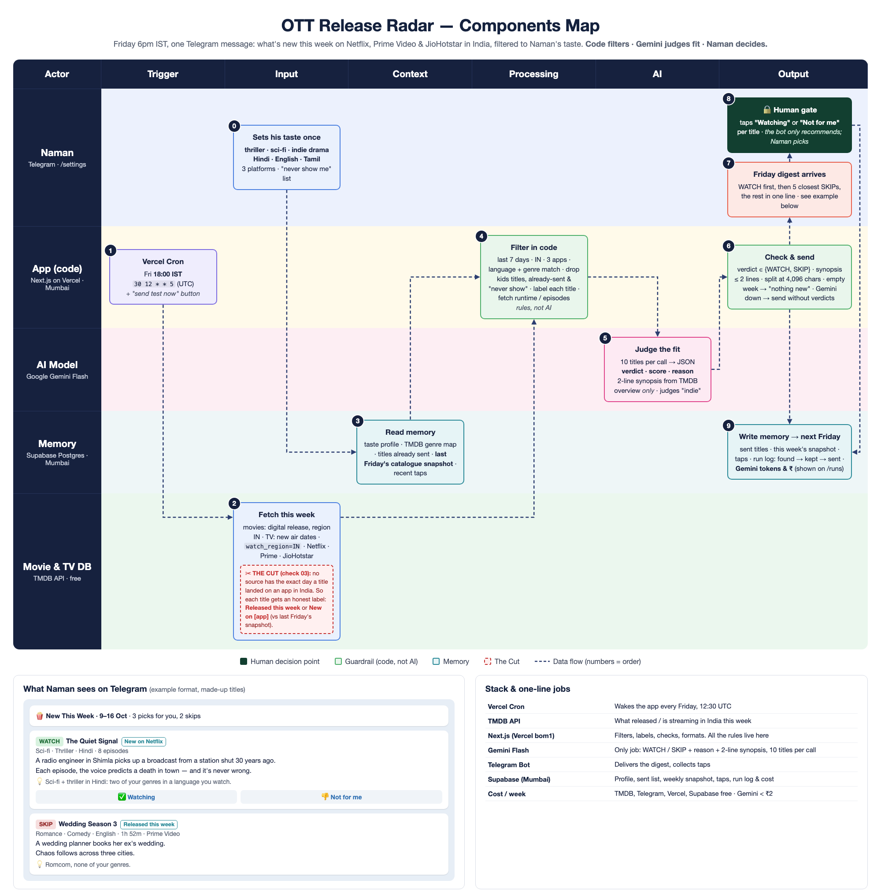

# OTT Release Radar

Every Friday at 6pm IST, Naman gets one Telegram message: what actually came out **this week** on
Netflix, Prime Video and JioHotstar **in India**, filtered to his genres (thriller, sci-fi, indie drama)
and languages (Hindi, English, Tamil). Each title has its platform, genre tags, runtime or episode count,
a two-line synopsis and a Gemini **WATCH / SKIP** verdict with a one-line reason.

**Code filters · Gemini judges fit · Naman decides.**

## Components map



Nine checks + the Cut: [docs/nine-checks.md](docs/nine-checks.md)

## How a Friday run works (`src/lib/pipeline.ts`)

1. **Vercel Cron** hits `/api/cron/digest` at `30 12 * * 5` (UTC) = Friday 18:00 IST.
2. **TMDB** (`src/lib/tmdb.ts`): movies with an India digital release in the last 7 days, direct-to-streaming
   premieres, new shows, and shows with an episode this week, all limited to the three apps in India (`watch_region=IN`).
3. **Memory** (Supabase Postgres, Mumbai): taste profile, titles already sent, last Friday's catalogue snapshot, recent taps.
4. **Filter in code**: on his apps in India · his languages · his genres · not kids/family · not just a weekly
   episode of an old show · no "never show" words · never sent before. Every drop is counted on the run page.
5. **Gemini Flash** (`src/lib/judge.ts`): 10 titles per call. It returns a synopsis written only from TMDB's overview, a 0-100 fit score,
   WATCH/SKIP and a reason. It also judges "indie", which TMDB has no genre for.
6. **Check & send**: the verdict must be WATCH/SKIP and the synopsis is clipped to 2 lines. Messages split under Telegram's 4,096-char limit.
   If Gemini is down, the digest goes out with TMDB's own overview and "no verdict". An empty week gets a "nothing new" message.
7. **Telegram**: WATCH first, then the 5 closest SKIPs, then the rest in one line.
8. **Human gate**: Naman taps "✅ Title" or "Not for me". The bot never adds anything to a watchlist.
9. **Write memory**: sent titles, this week's snapshot, taps (Gemini sees the last 8 weeks of them next Friday), tokens and ₹.

### The Cut
No public source has the exact day a title landed on an app in India. So every title is labelled honestly:
**Released this week** (TMDB release / premiere / new season date) or **New on [app]** (it wasn't in that app's
catalogue at last Friday's snapshot). The first real run sets the baseline snapshot.

## Pages
- `/`: next send time, Preview this week (sends nothing), Send digest now, run history and cost
- `/runs/[id]`: every title with its verdict, plus what the code filter dropped and why
- `/settings`: genres, languages, apps, never-show words, notes for the recommender
- `/setup`: connection status and the Telegram webhook button

Telegram commands: `/start` (connects the chat), `/now` (send this week's digest now), `/help`.

## Run locally
```
npm install
cp .env.example .env.local   # fill it in
npm run db:push              # creates the tables
npm run radar                # previews this week's digest in the terminal
npm run dev
```

## Notes
- Gemini free tier allows about 20 requests per day per model, so titles are judged 10 per call (about 3 calls a week).
  `GEMINI_MODEL` is a fallback chain of Flash models.
- Previews never move the catalogue snapshot forward or mark titles as sent, so they can be run any number of times.
- The dashboard is behind `APP_PASSWORD` (any username). The cron route and Telegram webhook check their own secrets.
- **Data stays in India:** Postgres is Supabase in `ap-south-1` (Mumbai), and Vercel functions are pinned to `bom1` (Mumbai) in `vercel.json`.
  TMDB, Gemini and Telegram are global APIs; the app only sends them titles and taste notes, never personal data.
