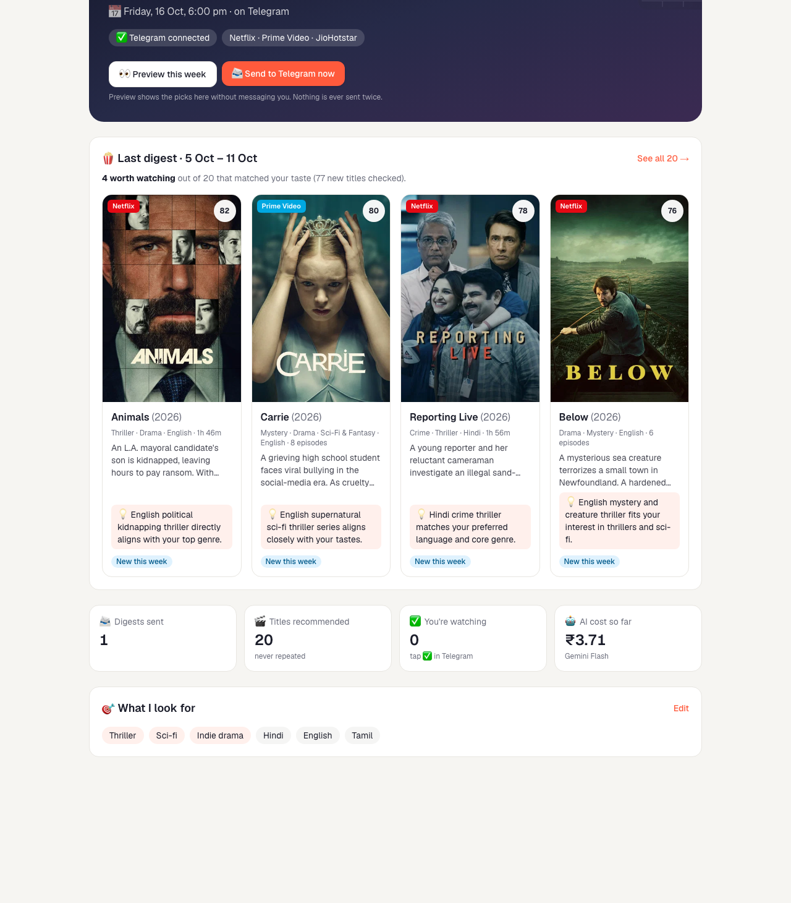
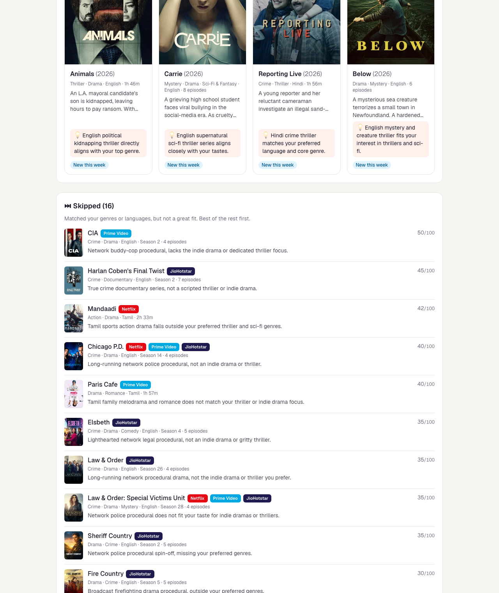

# OTT Release Radar — Submission

| Deliverable | Link |
|---|---|
| **Live app (Vercel)** | https://ott-release-radar-sable.vercel.app (login: username `naman` + password shared separately) |
| **GitHub repository** | https://github.com/gauraangichopra-ship-it/ott-release-radar |
| **Components Map** | [docs/components-map.png](components-map.png) |
| **Nine checks + the Cut** | [docs/nine-checks.md](nine-checks.md) |
| **Telegram bot** | [@naman_ott_radar_bot](https://t.me/naman_ott_radar_bot) |

## What it does
Every Friday at 6:00pm IST, Naman gets one Telegram message listing what actually released this week on
Netflix, Prime Video and JioHotstar **in India**, filtered to his genres (thriller, sci-fi, indie drama)
and languages (Hindi, English, Tamil). Each entry includes the title, platform, genre tags, runtime or
episode count, a two-line synopsis, and a Gemini Flash **WATCH / SKIP** call with a one-line reason.

## Stack
- **TMDB API**: India release dates and streaming availability (`watch_region=IN`)
- **Gemini Flash** (only AI used, no Claude API): synopsis + WATCH/SKIP, 10 titles per call
- **Next.js on Vercel**: functions pinned to Mumbai (`bom1`); Vercel Cron `30 12 * * 5` = Fri 18:00 IST
- **Supabase Postgres, Mumbai (`ap-south-1`)**: taste profile, sent titles, weekly catalogue snapshot, taps, costs
- **Telegram Bot API**: digest delivery + ✅ / "Not for me" buttons

## First real run (week of 5–11 Oct 2026)
77 new titles found → 20 matched his taste (code filter) → 4 WATCH, 16 SKIP (Gemini) · 42 seconds · ₹1.57

## The Cut
No public source records the exact day a title landed on a streaming app in India. Instead of claiming to,
each title is labelled **"New this week"** (release / premiere / new-season date in the window) or
**"Just added to [app]"** (absent from that app's catalogue in last Friday's snapshot).

## Screenshots

